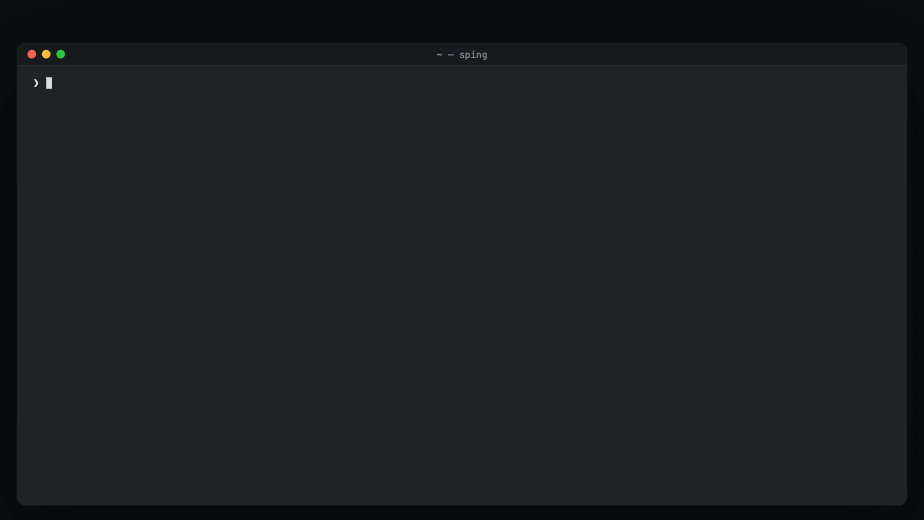

# sping

A modern ping for humans. Terminal-native, real-time connectivity monitor that doesn't just measure packets — **it interprets network context**.

<p align="center"></p>



**Status:** functional and in active use, with a frozen JSON contract.
Linux, macOS and Windows; x86_64, aarch64 and armv7 (Raspberry Pi).

Answers three questions at once:
1. **Does the target respond?** — RTT, TTL, jitter, loss, quality score, trend
2. **Do I have network from this interface?** — gateway reachable, WAN reachable
3. **What type of problem is it?** — correlated diagnostics, automatic

```
sping google.com (216.58.204.174) via eth0  ⠙ probing...

Pulse      █▇▆█▁▃█▄
Latency    now 13.8 ms · avg 13.9 ms · min 13.6 ms · max 14.1 ms · jitter 0.19 ms · dns 18.5 ms
Status     Reachable · loss 0% · sent 8 · recv 8 · ttl 112 · hops ~16
Context    if eth0 · 192.168.1.100/24 · gw ● · wan ● · public
Quality    A (100) · excellent
```

## What's new in 1.6.0

- **TCP connect probe** (`--tcp PORT`): times the TCP handshake where ICMP is
  filtered or not allowed. An open port and a refused one both answer; see
  [TCP connect](#tcp-connect).
- **The diagnosis as data**: JSON lines carry `diagnosis`, the findings as
  stable codes with their evidence, and in single-target mode the `gateway`
  and `wan` state they come from (see [JSON_CONTRACT.md](JSON_CONTRACT.md)).
- **Clearer wording**: the quality grades are named `excellent`, `good`,
  `fair` and `poor`; the TTL's OS hint appears only while the TTL is still an
  initial value; a loopback target is `loopback`.
- **Steadier scoring**: the grade and the jitter warning read the same 20
  probes, changes under 0.1 ms are noise, and lost probes count in the trend.
- **Static Linux binaries** (musl) for x86_64 and aarch64: Alpine and systems
  older than glibc 2.34 included.
- **Homebrew**: `brew install LambdaBytes/tap/sping`; every release also goes
  to crates.io.
- **Fixes**: `127.0.0.1` gets its loopback interface with `/8` on Linux,
  macOS and Windows; on macOS the gateway and the interfaces are found under
  cron too.

Every change, version by version: [CHANGELOG.md](CHANGELOG.md).

## Multi-target dashboard

```bash
sping 192.168.1.1 8.8.8.8 google.com
```

```
Target                      RTT        Avg   Loss    Qual      Trend        TTL  Hops
───────────────────────────────────────────────────────────────────────────────
192.168.1.1             0.31 ms    0.30 ms     0%    A100     stable   64(Unix)    ~0
8.8.8.8                 13.6 ms    13.6 ms     0%    A100     stable        112   ~16
google.com (216.58.…    13.7 ms    13.6 ms     0%    A100     stable        112   ~16
```

## Install

| Method | Command | Platforms | Man page and completions |
|--------|---------|-----------|--------------------------|
| Homebrew | `brew install LambdaBytes/tap/sping` | macOS | yes |
| crates.io | `cargo install sping` | Linux, macOS, Windows, with Rust 1.88+ | no |
| Pre-built binary | from the [Releases page](../../releases) | Linux, macOS, Windows | no |
| Debian / Ubuntu package | `.deb` from the [Releases page](../../releases) | Debian 12, Ubuntu 22.04, Raspberry Pi OS (Bookworm) or later | yes |
| From source | `cargo build --release` | Linux, macOS, Windows, with Rust 1.88+ | no |

### Homebrew

From v1.6.0 on. Builds from source and installs the binary, the man page and
the shell completions:

```bash
brew install LambdaBytes/tap/sping
```

### From crates.io

Requires Rust 1.88+. Installs the binary only (no man page or shell
completions):

```bash
cargo install sping
```

### Pre-built binaries

Download from the [Releases page](../../releases):

| Platform | Asset |
|----------|-------|
| Linux x86_64 | `sping-vX.Y.Z-linux-x86_64` |
| Linux aarch64 | `sping-vX.Y.Z-linux-aarch64` |
| Linux x86_64, static | `sping-vX.Y.Z-linux-x86_64-musl` |
| Linux aarch64, static | `sping-vX.Y.Z-linux-aarch64-musl` |
| Windows x86_64 | `sping-vX.Y.Z-windows-x86_64.exe` |
| macOS Apple Silicon | `sping-vX.Y.Z-macos-arm64` |
| Debian/Ubuntu amd64 | `sping_X.Y.Z-1_amd64.deb` |
| Debian/Ubuntu arm64 | `sping_X.Y.Z-1_arm64.deb` |

The Linux binaries and packages need glibc 2.34 or newer: Debian 12, Ubuntu
22.04, Raspberry Pi OS (Bookworm) or later. The `-musl` binaries are static
and run on any Linux of their architecture, Alpine and older systems
included.

Verify with `SHA256SUMS` from the same release. From v1.5.5 on, every file of
a GitHub release also has a build provenance attestation, which tells the
commit and the workflow run that produced it:

```bash
gh attestation verify sping-vX.Y.Z-linux-x86_64 --repo LambdaBytes/sping
```

### Debian / Ubuntu (.deb)

```bash
sudo dpkg -i sping_1.6.0-1_amd64.deb     # or _arm64.deb on aarch64
```

The package installs:
- binary at `/usr/bin/sping`
- man page (`man sping`)
- shell completions for bash, zsh and fish
- docs under `/usr/share/doc/sping/`

### macOS binary

From v1.5.5 on, the macOS binary of a release is signed with a Developer ID
and notarized by Apple, so it runs once it is made executable:

```bash
chmod +x sping-vX.Y.Z-macos-arm64
./sping-vX.Y.Z-macos-arm64 8.8.8.8
```

macOS refuses an earlier, unsigned binary until its quarantine attribute is
removed: `xattr -d com.apple.quarantine sping-vX.Y.Z-macos-arm64`.

### From source

Requires Rust 1.88+ (edition 2024 + let-chains).

```bash
git clone https://github.com/LambdaBytes/sping.git
cd sping
cargo build --release
# Binary at ./target/release/sping
```

## Usage

```bash
# Single target — compact view (default)
sping 8.8.8.8

# Multiple targets — dashboard table
sping 192.168.1.1 1.1.1.1 api.example.com

# Hostname
sping google.com

# Fast probing (200ms interval)
sping 8.8.8.8 -i 200

# Bind to an interface (Linux) / a source IP (Linux, macOS)
sping 8.8.8.8 -I eth0
sping 8.8.8.8 -S 192.168.1.100

# Another WAN reference for the gateway/WAN check (default 1.1.1.1)
sping 8.8.8.8 --wan-probe 9.9.9.9

# Ping-style flags: count, timeout, payload size, TTL, quiet, family
sping 8.8.8.8 -c 5                # stop after 5 probes (any view)
sping 8.8.8.8 -W 1                # 1s per-probe timeout
sping 8.8.8.8 -s 120              # 120-byte payload
sping 8.8.8.8 -t 10               # outgoing TTL / hop limit
sping 8.8.8.8 -c 10 -q --view classic  # quiet: summary only
sping example.com -4              # force IPv4 (-6 for IPv6)
sping fe80::1%eth0                # IPv6 link-local: the zone is required

# TCP connect instead of ICMP (see "TCP connect" below)
sping example.com --tcp 443
sping 192.168.1.1 10.0.0.5 --tcp 22   # every target, the same port

# ASCII-only output: automatic on non-UTF-8 locales and on the legacy
# Windows console (SPING_ASCII=0 forces Unicode); NO_COLOR honored
sping 8.8.8.8 --ascii

# List interfaces
sping --list-interfaces

# Debug mode
sping --debug 8.8.8.8
```

Exit codes are ping-compatible: `0` replies received, `1` no replies, `2` error.

### Batch mode

Probe a list of targets from a file:

```bash
# Create a hosts file (one target per line, # comments allowed)
cat > hosts.txt << EOF
8.8.8.8
1.1.1.1
google.com
192.168.1.20
EOF

# Summary to stdout (10 probes per host)
sping --batch hosts.txt -c 10

# JSON output
sping --batch hosts.txt -c 20 --view json

# Save to file
sping --batch hosts.txt -c 10 -o results.txt

# JSON to file
sping --batch hosts.txt -c 10 -o results.json --view json

# Fast interval
sping --batch hosts.txt -c 50 -i 200
```

Output (summary):
```
8.8.8.8                  10/10  0%  avg 13.6 ms  min 13.6 ms  max 13.7 ms  jitter 0.05 ms  ttl 112 hops ~16  A(100) stable
1.1.1.1                  10/10  0%  avg 20.0 ms  min 19.9 ms  max 20.1 ms  jitter 0.08 ms  ttl 52 hops ~12  A(100) stable
```

All targets are probed in parallel. Full diagnostics (quality, trend, spikes) included.

### Views

```bash
sping 8.8.8.8                    # compact (default) — fixed TUI
sping 8.8.8.8 --view extended    # compact + RTT dist + echo path
sping 8.8.8.8 --view classic     # traditional ping scrolling
sping 8.8.8.8 --view json        # NDJSON for scripting
sping 8.8.8.8 --view json | jq '{rtt: .rtt_last, ttl: .ttl, quality: .quality}'
```

### TCP connect

`--tcp PORT` times the TCP handshake with the port instead of sending ICMP
echoes. It needs no ICMP permission and gets through networks that filter
ICMP; it works in every mode (single target, multi-target, batch) and view.

- An open port (`Connected to`) and a refused one (`Refused by`) are both
  answers: something replied, with its time. A refusal may come from the
  target or from a device on the way (a firewall can refuse for it), so it
  shows the path works, not that the service is up. The summary counts them:
  `10 connects, 10 answered (3 refused), 0.0% loss`.
- No answer before `-W` is a loss; a local failure (no route, for example) is
  an error, as a failed ICMP send.
- On Windows each probe sends a single SYN, never retransmitted: Windows
  otherwise retries after a refusal and reports it only after about 2 s.
  Windows waits for the answer to that SYN about 3 s at most, so a `-W` above
  3 s ends there.
- `-W` is the connect timeout, `-t` the TTL / hop limit, `-4`/`-6` the
  family; `-S` binds the source address on every platform, Windows included;
  `-I` behaves as with ICMP. `-s` does not apply and is rejected.
- A source address that cannot be bound is an error (exit code `2`).
- TCP has no TTL to read: there is no `ttl`, OS hint or hop estimate. The
  views show the port (`tcp/443`) and how the last connect ended: the
  compact and extended views say it in Events (`TCP 443 connected · 21 ms`,
  `TCP 443 refused · host or firewall answered`, `TCP 443 timeout · no
  answer`), the table and batch lines as `open`, `refused`, `timeout` or
  `error`; JSON adds `probe`, `port`, `refused` and `tcp_state` (see
  [JSON_CONTRACT.md](JSON_CONTRACT.md)).
- The gateway and WAN probes of the compact and extended views stay ICMP.
- One new connection per probe, closed normally (no reset): each one
  established leaves a `TIME_WAIT` entry on this host, as any short
  connection does.

### ICMP permissions

sping works without admin/sudo on all platforms. On Linux it uses unprivileged
DGRAM ICMP sockets (the `net.ipv4.ping_group_range` sysctl, which covers all
users by default on Debian and most distributions), and falls back to a RAW
socket only when DGRAM is denied.

If DGRAM ICMP is restricted, widen the allowed group range:

```bash
sudo sysctl -w net.ipv4.ping_group_range='0 2147483647'
```

Two features require `CAP_NET_RAW` (the RAW fallback and interface binding with
`-I`/`--interface`). Grant it to the binary without running as root:

```bash
sudo setcap cap_net_raw+ep /usr/bin/sping
```

## Features

**Measurement**
- ICMP echo over IPv4 and IPv6 with its own implementation on each platform,
  no admin rights needed, and a **TCP connect probe** (`--tcp PORT`) where
  ICMP is filtered
- **Quality score** A–D (excellent, good, fair, poor; 0–100) over the last
  20 probes, with a **trend** (stable/improving/degrading) that counts lost
  probes
- **Spike detection** with adaptive threshold and cooldown
- **Outage timer** with recovery events
- RTT, jitter, loss and `mdev`; **RTT distribution** p50/p95/p99, range and
  spikes (extended view); kernel receive timestamps on Linux
- **TTL + hop count**: `ttl 116 · hops ~12`; an OS hint only while the TTL
  is still an initial value (`ttl 64 (Unix-like)`, `128 (Windows)`, `255
  (network)`): past a router the TTL no longer says who answered

**Network context and diagnosis**
- **Network context** of each target: interface, source address and prefix,
  default gateway and target class (same LAN, routed internal, public,
  default gateway, link-local, loopback)
- **GW/WAN auxiliary probes** with hysteresis (3 fails → offline, 2 ok →
  online); the WAN reference is `1.1.1.1` or `--wan-probe IP`
- **Diagnostic correlation**: "target unreachable · internet still OK",
  "gateway unreachable · local network issue likely"; in JSON as stable codes
  with their evidence
- While monitoring, hostnames are resolved again every 60 s: when the address
  leaves the DNS answer, sping moves to another one of the same family. In
  single-target mode the context is detected again every 15 s
- IPv6 link-local targets with their zone (`fe80::1%eth0`)

**Views and modes**
- Five views: compact (default), extended (adds the RTT distribution and the
  echo path), classic (ping-style), JSON and the multi-target table; the
  compact and extended views fall back to classic when the output is not a
  terminal
- The **pulse** bar of the recent probes, scaled to their own RTT range, with
  losses marked and spikes in color
- **Multi-target dashboard** and **batch mode** from a file (summary or JSON,
  to stdout or a file)
- **JSON output** — stable NDJSON format, with the diagnosis as codes and
  the gateway/WAN state it comes from, see [JSON_CONTRACT.md](JSON_CONTRACT.md)
- Ping-style flags (`-c`, `-W`, `-s`, `-t`, `-q`, `-4`/`-6`, `-i`, `-I`,
  `-S`) and ping-compatible exit codes
- ASCII output (`--ascii`, automatic on non-UTF-8 locales and on the legacy
  Windows console) and `NO_COLOR`
- Monitoring stops cleanly on Ctrl+C and on SIGTERM (Unix) and prints the
  final summary (every view but JSON); the classic, JSON and batch output
  handle a closed pipe (`sping … | head`)
- **Debug mode** — `--debug` or `SPING_LOG=debug`

**Distribution**
- Binaries for Linux x86_64 and aarch64 (glibc 2.34+, and static with musl),
  macOS arm64 and Windows x86_64; `.deb` packages with the man page and the
  shell completions; Homebrew and crates.io
- On GitHub releases: the macOS binary signed and notarized, and a build
  provenance attestation for every file

## Platforms

| Feature | Linux | macOS | Windows |
|---------|-------|-------|---------|
| IPv4 ICMP | DGRAM socket | DGRAM socket | IcmpSendEcho |
| IPv6 | ICMPv6 DGRAM | ICMPv6 DGRAM | Icmp6SendEcho2 |
| TTL / hop limit | recvmsg | IP header (IPv4), recvmsg (IPv6) | API (IPv4 only) |
| Gateway detection | /proc/net/route | `/sbin/route` | `route print` |
| Interface detection | /proc/net/route, if_inet6 | `/sbin/ifconfig` | GetAdaptersAddresses |
| `-I` interface | SO_BINDTODEVICE | accepted, no effect | warning, unbound |
| `-S` source | bind() | bind() | OS routes (TCP: bind()) |
| TCP connect | socket2 | socket2 | socket2 (Winsock) |
| Admin required | No | No | No |
| All views | full | full | full |

## Architecture

Own ICMP implementation per platform. No third-party ping libraries.

- Linux: `socket2` DGRAM (RAW fallback) + `libc` recvmsg for TTL / hop limit
- macOS: `socket2` DGRAM + IP header parsing for the IPv4 TTL, recvmsg for the
  IPv6 hop limit
- Windows: `IcmpSendEcho` / `Icmp6SendEcho2` FFI from `iphlpapi.dll`
- TCP connect (`--tcp`): `socket2` on every platform, one connection per probe

Async Tokio runtime, `watch` channels, single-writer renderer at 10 FPS.

### Supported architectures

`x86_64`, `aarch64` and `armv7` (armhf) are compile-checked; aarch64/armv7 cover
Raspberry Pi OS (64- and 32-bit). Release artifacts are produced for Linux
x86_64/aarch64 (glibc, and static with musl), macOS arm64 and Windows x86_64.

## Known limitations

- `-I`/`--interface` binds only on Linux: macOS accepts the flag but it has
  no effect, Windows prints a warning and probes unbound. `-S`/`--source` is
  ignored by ICMP on Windows, where the OS picks the route; `--tcp` binds it.
- The raw-socket fallback and `-I` need `CAP_NET_RAW` (see
  [SECURITY.md](SECURITY.md)); the unprivileged DGRAM path covers the common
  case.
- Names go through the system resolver (5 s timeout) and are resolved again
  every 60 s while monitoring; sping does no reverse DNS and keeps no DNS
  cache of its own.
- The static `-musl` binaries resolve names with musl's own resolver:
  `/etc/hosts` and the servers in `/etc/resolv.conf`, without the system's
  NSS modules (mDNS `.local` names, for example, do not resolve).
- IPv6 replies carry a hop limit (`ttl`) on Linux and macOS; on Windows it
  is not shown (`0` in JSON). Gateway detection and `--list-interfaces` are
  IPv4 only.
- With `--tcp`, the gateway and WAN probes stay ICMP: without ICMP permission
  they are disabled with a warning and show `?`.
- An IPv6 link-local target needs its zone: `fe80::1%eth0`, or the interface
  index (`fe80::1%2`), which is the only form Windows takes.

## Roadmap

- Distribution packaging: AUR, Fedora/COPR, Debian/Raspberry Pi OS (work in
  progress under [`packaging/`](packaging/)).
- nixpkgs: the package is under review.

## Performance

| Metric | Value |
|--------|-------|
| Binary | 1.6 MiB (stripped + LTO) |
| RAM | ~4 MB resident |
| CPU | < 1% at two probes per second |
| Code | ~10,800 lines Rust |
| Tests | 207 (177 unit + 30 E2E) |

## License

MIT
